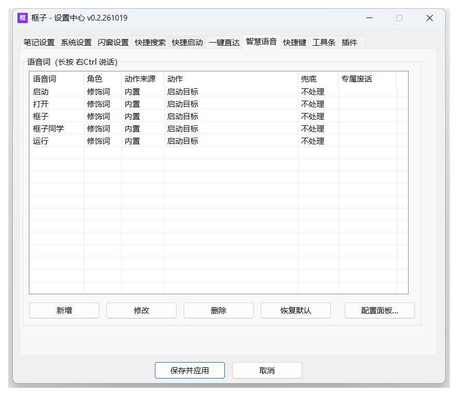
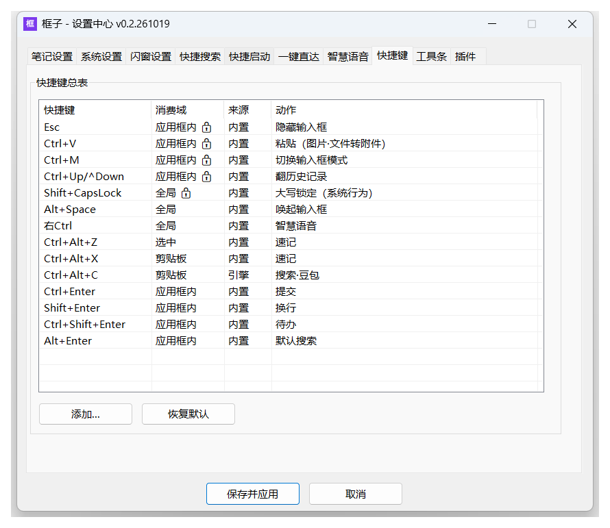
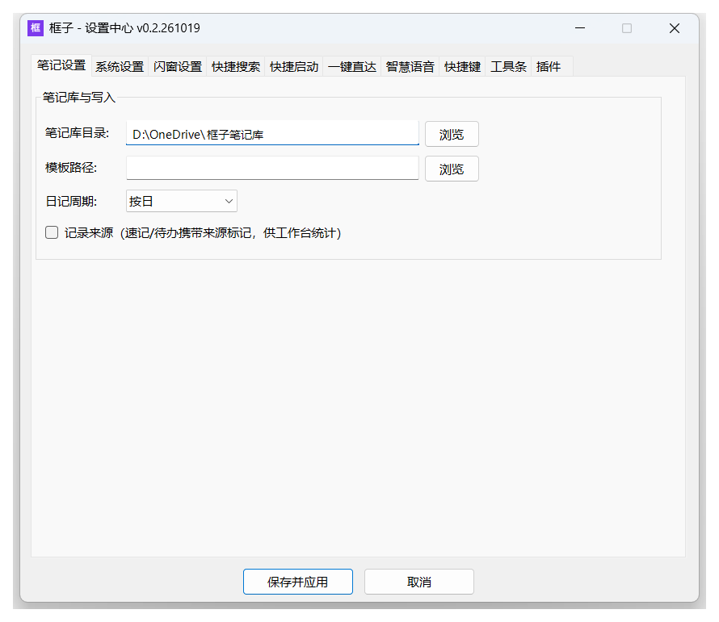
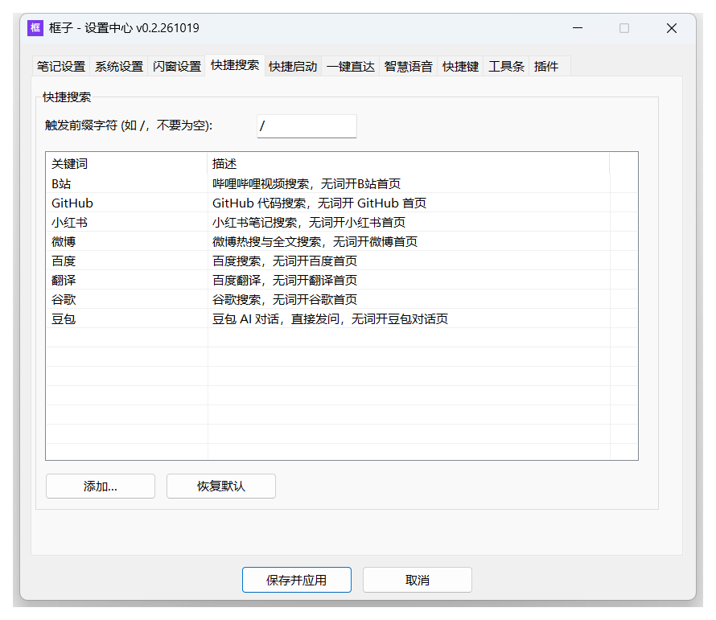
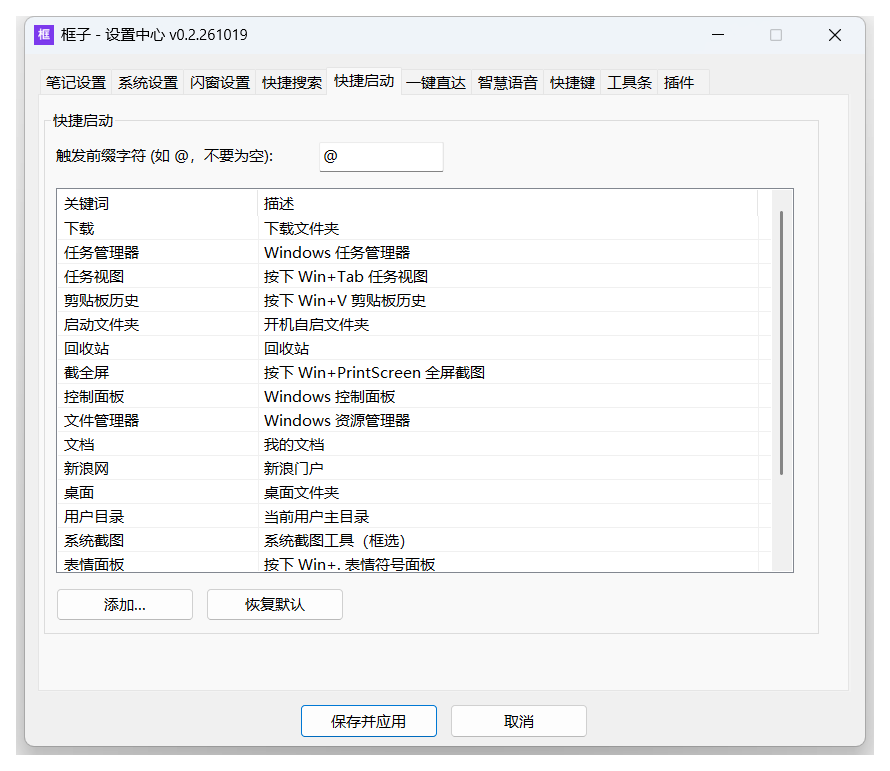
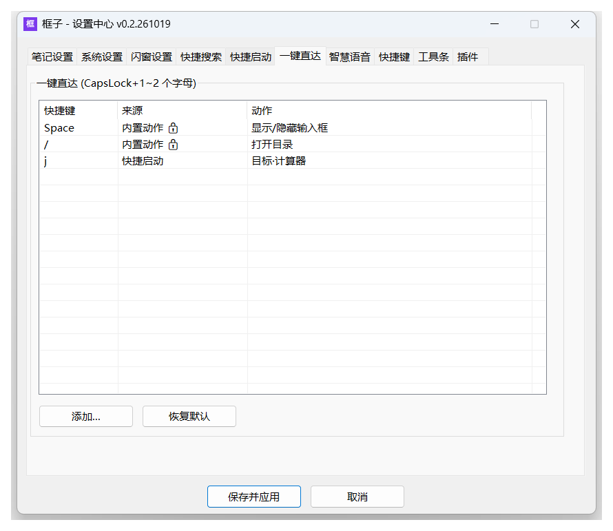
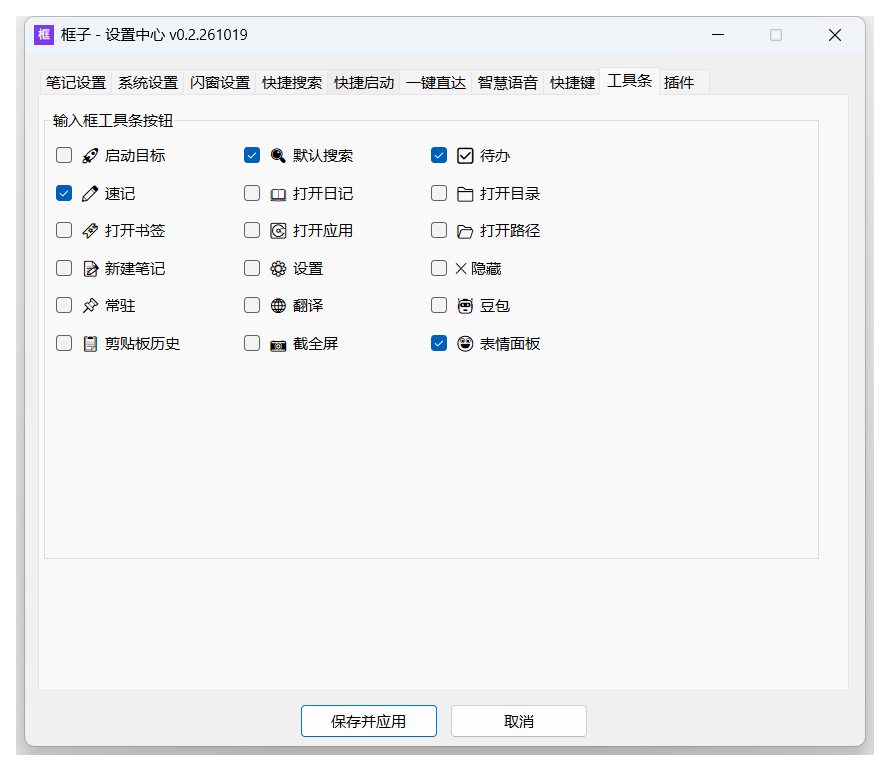
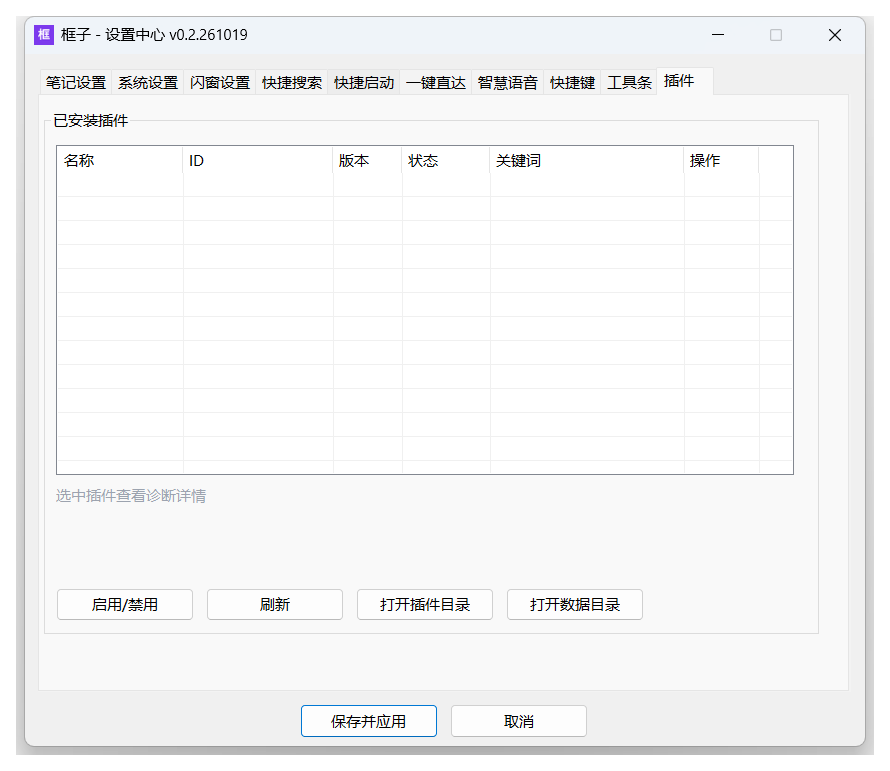

# 框子（kuangzi）

**AI 原生的多功能输入框** —— 一个热键唤起，打字、回车，完事。

速记落进本地 Markdown、`/` 开搜索引擎、`@词` 启动应用、`CapsLock+字母` 一键直达、按住右 Ctrl 说话……所有事都从一个框进出。


## 它是什么

框子常驻托盘，按一下热键就在屏幕中间弹出输入框。你只管把想法打进去，回车之后它自己判断这句话该去哪：记下来、搜出去、还是打开某个东西。

| 能力 | 一句话 | 入口 |
|---|---|---|
| 随手记 | 一行文字落进本地 Markdown 日记，自动带时间戳 | 打字 + 回车 |
| 随手搜 | 百度/谷歌/B站/微博/GitHub/小红书……想搜就搜 | `/` 开头 |
| 快捷启动 | 启动应用、打开目录、直达网址，已开的窗口是激活不是重开 | `@` 开头 |
| 待办 | 记成待办，跨天跨设备统一查询与勾销 | `-` 开头 |
| 一键直达 | `CapsLock + 字母` 一个动作，不唤起输入框 | CapsLock 组合键 |
| 语音 | 按住右 Ctrl 说话，识别结果走同一套路由 | 长按右 Ctrl |
| 插件 | 计算器、AI 面板这类独立小工具，按协议挂进来 | `$` 开头 |

数据全部是本地文件：日记是纯 Markdown，配置在用户目录，无云服务、无遥测。

## 安装

### 让 AI 助手帮你装（推荐）

把本页链接发给你的 AI 助手（ZCode 等），说一句 **"帮我装框子"**。它会照着仓库 `skills/kuangzi-install` 的流程下载、安装、配好热键与命令行，顺手把 `skills/` 下的技能装进自己——从此"记一下"就是原生的。

### 手动安装

1. 打开 [Releases](https://gitee.com/maxiaozhong/kuangzi-ahk/releases)，下载 `kuangzi-setup-v*.exe`
2. 双击安装（用户级安装，**不需要管理员权限**；安装位置可自定义）
3. 装完按 `Alt+Space`——框子已经在工作了

卸载：开始菜单 → 框子 → 卸载框子，可选是否同时删除数据（笔记库文件不受影响）。

## 30 秒上手

装好之后先试这四件事：

| 输入 | 结果 |
|---|---|
| `下班买菜` 回车 | 一条速记落进今天的日记（自动带时间戳） |
| `/b站 自动托管` | 打开 B 站搜索结果页 |
| `@计算器` | Windows 计算器打开（已运行则激活窗口） |
| 点工具条最右边的 😀 | Windows 表情符号面板弹出 |

输入框底部默认一排按钮：**启动目标 / 搜索 / 速记 / 待办 / 表情面板**——鼠标党不用记符号，点一下就是那个动作（按钮可换，见「设置中心 → 工具条」）。

## 核心用法

### 随手记：唤起 → 打字 → 回车


文字落进当天的日记文件，速记与待办同文件分节，纯 Markdown：

```markdown
## 框子待办

- [ ] 2026-10-17 14:30:05
  下午三点开会

## 框子速记

- 2026-10-17 14:30:12
  下班买菜
```

- 行首 `-` = 记待办，其他 = 记速记；多行整段保留
- 图片、文件直接拖进输入框 = 附件（复制进附件目录，日记里留引用，单文件上限 200MB）
- 日记按周期分文件，默认按天（`2026-10-17_day.md`），可切周/月
- 不唤起输入框也能记：`Ctrl+Alt+Z` 把当前选中的文字直接记，`Ctrl+Alt+X` 复制后记

日记就是普通文件，Obsidian、记事本、任何编辑器都能直接打开——数据永远在你自己手里。

### 随手搜：`/` 开头


- `/关键词` → 默认引擎（默认百度）
- `/b站 关键词`、`/GitHub ahk`、`/翻译 hello` → 指定引擎
- 只给引擎名（`/小红书`）→ 开该站首页

引擎表内置百度、谷歌、B站、微博、GitHub、小红书、豆包、翻译等，引擎词也进输入框的实时候选：直接打 `b站 直播` 也能搜。加自己的引擎：设置 → 快捷搜索里加一行，或对 AI 说一句"以后搜索用知乎"——也行这条命令：

```bash
kuangzi engine add 知乎 "https://www.zhihu.com/search?q=%s" --home https://www.zhihu.com --desc "知乎搜索"
```

### 待办：`-` 开头


`- 下午三点开会` 记待办，`Ctrl+Shift+Enter` 也能把当前这条直接转成待办。之后的检索与勾销交给词表、CLI 或 AI：

```bash
kuangzi todos --days 7      # 最近一周还没做完的
kuangzi done "开会"          # 关键词命中即勾销（多候选会列出来让你换个精确词）
```

### 快捷启动：`@` 开头

- `@词` 显式启动：先查词表，再查个人挂载目录，再查应用与书签目录，层层找；命中多个会弹出候选菜单
- 已运行的应用是**激活窗口**，不会重复开一个
- 默认词表带常用系统入口：计算器、任务管理器、控制面板、桌面、下载、回收站、系统截图……

把常用目录挂进来，之后输入文件名即直达（目录内容递归可搜，依赖目录自动剪枝）：

```bash
kuangzi path add "D:\客片"        # 或对 AI 说"把 D:\客片 挂到框子 path"
kuangzi path rename 客片 婚纱客片   # 改个顺口的词
```

单文件也能挂进词表（AI 同样能代劳，宿主运行中改完即生效）：

```bash
kuangzi word add 微信 "D:\Program Files\WeChat\WeChat.exe" --desc "微信桌面版"
```

### 一键直达：CapsLock 组合键

按住 CapsLock + 字母/符号就是一个动作，出厂示例：

| 按键 | 动作 |
|---|---|
| `CapsLock+Space` | 显示/隐藏输入框 |
| `CapsLock+/` | 打开笔记目录 |
| `CapsLock+J` | 计算器 |

在「设置 → 一键直达」里自由绑定：任何词表词、搜索、插件动作、系统动作都能挂上去。

### 语音：按住右 Ctrl 说话



说话内容转成文字进输入框，走同一套路由——话里带"待办""打开"这类词，就按对应语义分发。用的是 Windows 自带的语音识别，**不出网**。语音词表、专属词、修饰词都在设置里可调。

### 热键总表

| 热键 | 动作 |
|---|---|
| `Alt+Space` | 唤起 / 隐藏输入框 |
| `Enter` / `Ctrl+Enter` | 提交（普通模式回车换行、极速模式回车提交，两档可切） |
| `Shift+Enter` | 换行 |
| `Ctrl+Shift+Enter` | 本条记为待办 |
| `Alt+Enter` | 本条走搜索 |
| `Esc` | 隐藏输入框 |
| `Ctrl+V` / `Ctrl+M` | 粘贴 / 粘贴（截图、文件等附件形态） |
| `Ctrl+Up` / `Ctrl+Down` | 翻历史记录 |
| `Ctrl+Alt+Z` / `Ctrl+Alt+X` | 选中文字记速记 / 复制后记速记 |
| `Ctrl+Alt+C` | 复制后发给豆包问 |
| `Ctrl+/` | 打开设置 |
| `Shift+CapsLock` | 大小写锁定 |

全部热键在「设置 → 快捷键」的一张总表里管理，每条都标着来源（内置 / 词表 / 引擎 / 插件），哪些能改一目了然。



## 设置中心

托盘右键 → 设置（或输入词 `设置`），十个页签覆盖全部可调项：













## AI 原生

框子把智能体当第一等公民。装好框子后，给你的 AI 助手（ZCode 等）装上仓库 `skills/` 下的技能，就能对话式使用与配置：

```
你：框子，记一下明天下午两点牙医
AI：已记待办 → D:\...\2026-10-17_day.md

你：今天我都记了啥？
AI：（kuangzi daily 取数后归纳）今天 17 条速记、3 个待办，主要围绕……

你：把 D:\客片 挂到框子 path，改名叫婚纱客片
AI：已挂载，输入 婚纱客片 直达

你：帮我装个计算插件
AI：（读插件协议 → 装好 → 刷新宿主）装好了，输入 $计算 1+2 试试
```

不会改配置文件没关系——**说一句人话，智能体替你办**。

### CLI：同一份数据，无界面入口

`kuangzi` 命令行与 GUI 共享同一份配置和日记库，跑完即退，适合脚本与智能体调用：

```bash
kuangzi note "下班买菜"        # 速记
kuangzi todo "周五交周报"      # 待办
kuangzi daily --json          # 今天的速记 + 待办，一次取全
kuangzi note --date 2026-10-15 # 查某天的速记
kuangzi find "发票"            # 全文行检索
kuangzi go "b站 手冲咖啡"       # 智能路由，与输入框同一套判断
kuangzi archive --month       # 归档上个月（先预览，确认后 --go）
```

`--json` 输出单行 JSON，退出码契约固定：**0 成功 / 1 失败 / 2 多候选 / 3 用法错误**。完整命令与字段见 [CLI 手册](doc/cli.md)。

## 插件

框子支持插件扩展。官方演示插件**框子计算**在 [Releases](https://gitee.com/maxiaozhong/kuangzi-ahk/releases) 下载，或者直接对 AI 说"帮我装计算插件"。

想自己写？协议很简单（`invoke.v1`），框子计算本身就是模板，见 [插件开发文档](doc/plugin-dev.md)。插件申请敏感权限（读剪贴板、读前台窗口）必须显式声明，装之前你能看到它要什么。

## 数据与隐私

- 日记与附件都是本地 Markdown / 文件，存在你指定的笔记库目录（默认 OneDrive 下的 `框子笔记库`，挂同步盘就自动多设备同步）
- 程序配置在 `~/.kuangzi/data/kuangzi-app/`，卸载时可选保留或清除
- 多设备各自写各自的分区（`kuangzi-data/<设备名>/`），读取端全量合并——换电脑不冲突
- 历史日记积多了用 `kuangzi archive` 按月归档（跨设备合并，先预览再执行）
- 无云服务、无遥测；语音识别走系统能力，不出网

## 从源码构建

仓库即完整源码，两步：

1. 安装 [AutoHotkey v2](https://www.autohotkey.com/)（官方安装包自带 Ahk2Exe 编译器）
2. 仓库根运行：

```powershell
powershell -ExecutionPolicy Bypass -File tools\build.ps1
```

四个产物落在 `build\`：`kuangzi.exe`（宿主）、`kuangzi-cli.exe`（CLI）、`kuangzi-uninstall.exe`（卸载器）、`kuangzi-setup-v<版本>.exe`（安装器）。

不想编译也可以直接跑源码：`AutoHotkey64.exe kuangzi.ahk`（源码态 CLI 在真实终端里没有回显，属正常，编译版才有）。

## 文档

| 文档 | 内容 |
|---|---|
| [使用教程](doc/usage.md) | 输入框全能力：路由语法、词表、path 挂载、热键、语音、源码构建、FAQ |
| [CLI 手册](doc/cli.md) | 命令行接口（供智能体与脚本调用，含 JSON 契约） |
| [插件开发](doc/plugin-dev.md) | 插件协议 `invoke.v1` 与 manifest 规范 |

## 声明

个人学习项目，作者 maxiaozhong。软件按"现状"免费提供，不附带任何保证，使用者风险自负；许可证见 [LICENSE.txt](LICENSE.txt)。

- 本项目基于 [AutoHotkey v2](https://www.autohotkey.com/) 构建，并使用了 thqby/HotKeyIt 的 [JSON.ahk](https://github.com/thqby/ahk2_lib) 等开源库，感谢以上作者
- 本软件为个人学习交流用途，不作任何商业用途；如有侵权请联系作者删除
- 仅供个人学习使用，请勿用于商业用途或再分发